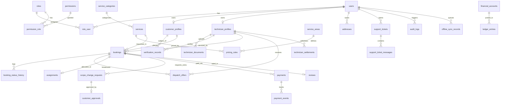

# مستند جامع مدل داده‌ها و دیاگرام روابط موجودیت‌ها (Database & Domain Model)
**پروژه:** سامانه جامع خدمات کلیدسازی و امنیت آنلاین KeyPro  
**نسخه سند:** ۱.۰.۰  
**فاز:** فاز دو (تثبیت مدل داده و مایگریشن‌ها)  

---

## ۱. دیاگرام روابط موجودیت‌ها (Entity Relationship Diagram - ERD)

---

## ۲. مشخصات و تعاریف جداول پایگاه داده

### ۲.۱. ماژول هویت و دسترسی (IAM & RBAC)
- **`users`:** حساب کاربری پایه، شماره همراه ایران با قید یکتا (`phone_number UNIQUE`)، کد ملی (`national_id UNIQUE`)، وضعیت فعال/مسدود (`status`).
- **`roles`:** نقش‌های سازمانی (`customer`, `technician`, `operator`, `dispatcher`, `finance`, `admin`).
- **`permissions`:** مجوزهای ریزدانه سرورمحور تفکیک‌شده بر اساس نام ماژول.
- **`role_user` & `permission_role`:** جداول رابط چندبه‌چند با کلیدهای اصلی ترکیبی (`Composite Primary Keys`) و `CASCADE` در حذف.
- **`otp_verifications`:** جلسات صدور و انقضای کد پیامکی ۶ رقمی یکبار مصرف با محدودیت زمانی و شمارش تلاش‌ها (`attempts`).

### ۲.۲. پروفایل‌ها و احراز صلاحیت انتظامی (Profiles & Verification)
- **`customer_profiles`:** متصل یک‌به‌یک به کاربر، تاریخچه سفارش‌های موفق و امتیاز اعتباری مشتری.
- **`technician_profiles`:** مشخصات تخصصی کلیدساز، شماره پروانه کسب اتحادیه (`license_number UNIQUE`)، وضعیت شیفت کاری (`is_online`, `is_available`)، مختصات جغرافیایی زنده با ایندکس عددی (`current_lat`, `current_lng`)، نوع وسیله نقلیه و آرایه مهارت‌ها.
- **`technician_documents`:** بارگذاری امن اسناد هویتی و پروانه کسب، وضعیت بررسی توسط ناظر و دلایل رد احتمالی.
- **`verification_records`:** ثبت الزامی مدارک اثبات مالکیت مسکن، اتومبیل یا گاوصندوق قبل از بازگشایی قفل با امضای دیجیتال مشتری.

### ۲.۳. کاتالوگ خدمات، مناطق جغرافیایی و قیمت‌گذاری پویا (GIS & Pricing)
- **`service_categories` & `services`:** دسته‌بندی خدمات قفل و کلید با نرخ پایه (`base_price DECIMAL(12,2)`).
- **`service_areas`:** محدوده شهری با مختصات مرکز، شعاع بر حسب کیلومتر و چندضلعی GeoJSON.
- **`pricing_rules`:** نرخ به ازای هر کیلومتر مسافت، ضریب شبانه (ساعت ۲۲ الی ۶ صبح)، ضریب اضطراری و کف قیمت سفر.
- **`addresses`:** موقعیت‌های جغرافیایی ذخیره‌شده کاربران با مختصات `latitude` و `longitude`.

### ۲.۴. سفارش، دیسپچ و تغییر محدوده کار (Bookings & State Transitions)
- **`bookings`:** موجودیت اصلی سفارش با شناسه منحصربه‌فرد `booking_code` (UUID)، ماشین وضعیت ۱۰ مرحله‌ای، موقعیت جغرافیایی و هزینه‌ها.
- **`booking_status_history`:** ردیابی و تاریخچه غیرقابل تغییر تغییر وضعیت‌ها با ثبت موقعیت کلیدساز و کاربر تغییردهنده.
- **`dispatch_offers` & `assignments`:** سیستم پیشنهاد مأموریت به کلیدسازان با مهلت زمانی و قفل اختصاصی راننده با قید یکتایی `UNIQUE(booking_id)` در تخصیص.
- **`scope_change_requests` & `customer_approvals`:** گردش کار رسمی ثبت هزینه مازاد توسط کلیدساز در محل و لزوم تایید دیجیتال مشتری قبل از اعمال مالی.

### ۲.۵. مالی، تراکنش‌ها و دفتر کل دوطرفه (Finance & Double-Entry Ledger)
- **`financial_accounts`:** حساب‌های کل، معین و تفصیلی بر اساس استانداردهای حسابداری (دارایی، بدهی، سرمایه، درآمد و هزینه).
- **`payments`:** تراکنش‌های درگاه پرداخت با شناسه یکتای تکرارناپذیری (`idempotency_key UNIQUE`) و کد پیگیری شاپرک.
- **`payment_events`:** ثبت لاگ تمام کال‌بک‌ها و رویدادهای پرداخت.
- **`ledger_entries`:** اسناد حسابداری دوطرفه هم‌تراز (`debit = credit`) با شناسه گروه تراکنش (`transaction_group_id UUID`).
- **`technician_settlements`:** مدیریت پرداخت‌های پایای بانکی با تایید شماره شبای معتبر و تطبیق هویت دارنده حساب.

### ۲.۶. پشتیبانی، نظرات و همگام‌سازی آفلاین (Reviews, Support & Sync)
- **`reviews`:** ثبت نظر و امتیازدهی تفکیکی (اخلاق، مهارت، قیمت منصفانه).
- **`support_tickets` & `support_ticket_messages`:** تیکت‌های پشتیبانی و حل اختلاف در محل با اولویت‌بندی.
- **`notifications_log`:** لاگ ارسال پیامک‌ها و اعلانات با پشتیبانی از آداپتورهای پیامکی.
- **`audit_logs`:** ردیابی امنیتی عملیات با ثبت IP، متادیتا و مقادیر قبل و بعد (`old_values`, `new_values`).
- **`offline_sync_records`:** صف درخواست‌های آفلاین با شناسه کلاینت (`client_record_uuid UUID`) جهت جلوگیری از ثبت تکراری پس از وصل مجدد اینترنت.
