# تفکیک ۲۵ ماژول دامنه، مرزهای تراکنش و قراردادهای داده (25 Domain Modules & API Contracts)
**پروژه:** پلتفرم آنلاین خدمات کلیدسازی KeyPro (الهام‌گرفته از الگوهای محصولی LockAtlas، متناسب با بازار ایران)  
**نسخه سند:** ۲.۰.۰ (تثبیت جامع فاز صفر)  
**سبک ساختاری:** Modular Monolith بر مبنای معماری دامنه‌محور (Domain-Driven Design)

---

## ۱. نقشه کلان ۲۵ ماژول دامنه (Comprehensive Domain Map)

برای انطباق دقیق با استانداردهای محصولی تجاری و جلوگیری از انباشت منطق در کنترلرها یا فرانت‌اند، معماری سیستم به ۲۵ ماژول تفکیک شده است:

```mermaid
graph TD
    subgraph IAM_Sub [مدیریت هویت و دسترسی]
        M01[1. Identity & Access Management]
        M02[2. Customer Management]
        M03[3. Technician Management]
        M04[4. Technician Verification / KYC]
    end

    subgraph Catalog_Pricing_Sub [کاتالوگ، قیمت و کارشناسی]
        M05[5. Service Catalog]
        M06[6. Pricing Engine]
        M07[7. Price Estimates]
        M08[8. Lock Photo Assessment]
    end

    subgraph Order_Dispatch_Sub [چرخه سفارش و اعزام هوشمند]
        M09[9. Booking Management]
        M10[10. Dispatch Engine]
        M14[14. Scope Change Approval]
    end

    subgraph GIS_Map_Sub [زیرساخت مکانی و نقشه آفلاین]
        M11[11. Geographic Services PostGIS]
        M12[12. Offline Maps Cache]
        M13[13. Live Location Telemetry]
        M25[25. Offline Synchronization]
    end

    subgraph Finance_Sub [مالی، تراکنش و تسویه حساب]
        M15[15. Payments Shaparak]
        M16[16. Financial Ledger Double-Entry]
        M17[17. Technician Settlements Sheba]
    end

    subgraph Operations_Support_Sub [عملیات، پشتیبانی و مانیتورینگ]
        M18[18. Notifications SMS/Push]
        M19[19. Reviews & Reputation]
        M20[20. Support & Disputes]
        M21[21. Admin Operations]
        M22[22. Content & SEO]
        M23[23. Reporting & Analytics]
        M24[24. Audit & Security Logs]
    end

    M09 -->|استعلام نرخ و تخمین| M06
    M06 -->|کاتالوگ پایه| M05
    M09 -->|عکس قفل| M08
    M09 -->|اعزام مکانی| M10
    M10 -->|جستجوی KNN و شعاع| M11
    M10 -->|وضعیت شیفت| M03
    M09 -->|ردیابی زنده| M13
    M09 -->|تغییر فاکتور حین کار| M14
    M09 -->|تراکنش مالی| M15
    M15 -->|دفتر کل دوطرفه| M16
    M16 -->|تسویه حساب| M17
    M09 -->|رویدادهای چرخه سفر| M18
    M09 -->|ثبت نظر و امتیاز| M19
    M21 -->|نظارت و مداخله| M09
    M21 -->|تایید مدارک| M04
    M24 -->|حسابرسی امنیتی کلیه ماژول‌ها| M01
```



---

## ۲. مشخصات و قراردادهای تفصیلی ۲۵ ماژول دامنه

### ۲.۱. Identity & Access Management (IAM)
- **مسئولیت:** ثبت‌نام و ورود شماره همراه ایران (OTP)، نشست‌ها، صدور توکن Bearer (Sanctum)، مدیریت نقش‌ها و مجوزها (RBAC).
- **مالکیت داده:** `users`, `roles`, `permissions`, `role_user`, `otp_sessions`, `personal_access_tokens`.
- **رویدادها:** `UserRegistered`, `UserAuthenticated`, `OtpGenerated`.
- **خطاها:** `AUTH_INVALID_OTP`, `AUTH_RATE_LIMITED`, `ACCOUNT_LOCKED`.

### ۲.۲. Customer Management
- **مسئولیت:** پروفایل مشتریان حقیقی و حقوقی، آدرس‌های منتخب مکانی، مشخصات تماس و تاریخچه درخواست‌ها.
- **مالکیت داده:** `customers`, `customer_saved_addresses`.
- **مجوزها:** `customer.manage_own_profile`.

### ۲.۳. Technician Management
- **مسئولیت:** پروفایل شغلی متخصص/کلیدساز، مهارت‌ها (قفل ایمن، خودرو، گاوصندوق، ریموت)، وضعیت شیفت (آنلاین/آفلاین/مشغول)، وسیله نقلیه.
- **مالکیت داده:** `technicians`, `technician_skills`, `technician_work_zones`.
- **رویدادها:** `TechnicianShiftStatusChanged`.

### ۲.۴. Technician Verification (KYC & Legal)
- **مسئولیت:** احراز هویت انتظامی، استعلام جواز کسب، گواهی عدم سوءپیشینه، احراز مدارک هویتی قبل از تایید حساب.
- **مالکیت داده:** `technician_verifications`, `technician_documents`.
- **مجوزها:** `admin.verify_technician`.

### ۲.۵. Service Catalog
- **مسئولیت:** دسته‌بندی و لیست تفصیلی خدمات قفل و کلید، قطعات یدکی، سختی کار فنی و ابزارهای موردنیاز.
- **مالکیت داده:** `service_categories`, `service_items`, `service_addons`.

### ۲.۶. Pricing Engine
- **مسئولیت:** موتور فرمول‌بندی قیمت پویا (تعرفه پایه، ضریب مسافت، ضریب ساعات شبانه، ضریب ترافیک و سختی قفل).
- **فرمول محاسباتی:**
  $$\text{Price} = \text{BaseRate} + (\text{DistanceKm} \times \text{KmRate}) + (\text{ToolComplexity}) \times \text{TimeMultiplier}$$
- **مالکیت داده:** `pricing_rules`, `surge_zones`, `tariff_schemes`.

### ۲.۷. Price Estimates
- **مسئولیت:** برآورد حدود قیمت برای مشتری قبل از نهایی‌سازی سفارش، محاسبه دامنه کمینه و بیشینه بر اساس شرح مشکل.
- **مالکیت داده:** `price_estimates`.

### ۲.۸. Lock Photo Assessment
- **مسئولیت:** بارگذاری و تحلیل عکس‌های ارسالی مشتری از کلید یا قفل معیوب جهت پیش‌تشخیص و راهنمایی متخصص در انتخاب ابزار.
- **مالکیت داده:** `lock_assessments`, `lock_assessment_photos`.

### ۲.۹. Booking Management (ماشین وضعیت چرخه سفارش)
- **مسئولیت:** مدیریت چرخه سفارش از ثبت تا تحویل؛ نظارت بر ترنزیشن‌های مجاز ماشین وضعیت:
  `DRAFT` → `BROADCASTING` → `ASSIGNED` → `EN_ROUTE` → `ARRIVED` → `IN_PROGRESS` → `PAYMENT_PENDING` → `COMPLETED` / `CANCELLED`.
- **مالکیت داده:** `bookings`, `booking_state_transitions`, `cancellation_logs`.
- **رویدادها:** `BookingCreated`, `BookingAssigned`, `BookingStatusUpdated`, `BookingCompleted`.

### ۲.۱۰. Dispatch Engine
- **مسئولیت:** الگوریتم توزیع سفارشات بین متخصصان آنلاین در شعاع بهینه با تکیه بر کوئری‌های PostGIS و منطق Time-to-Accept.
- **مالکیت داده:** `dispatch_batches`, `dispatch_offers`.

### ۲.۱۱. Geographic Services (PostGIS Engine)
- **مسئولیت:** توابع مکانی، تبدیل مختصات WGS84، مرزبندی ژئومتری مناطق، جستجوی نزدیک‌ترین متخصصین (`ST_DWithin`, KNN).
- **مالکیت داده:** `geo_zones`, `coverage_areas`.

### ۲.۱۲. Offline Maps
- **مسئولیت:** تولید و مدیریت بسته‌های کش کاشی‌های OpenStreetMap در IndexedDB، متادیتا و کنترل حجم بسته‌های شهرهای ایران.
- **مالکیت داده:** `map_packages`, `offline_tile_metadata`.

### ۲.۱۳. Live Location (Telemetry)
- **مسئولیت:** دریافت و نگهداری آخرین ردپای جغرافیایی متخصص حین ماموریت فعال، محاسبه تخمین زمان رسیدن (ETA) و رد پرش‌های غیرعادی (Anti-GPS Spoofing).
- **مالکیت داده:** `technician_live_locations`, `telemetry_logs`.

### ۲.۱۴. Scope Change Approval
- **مسئولیت:** مدیریت درخواست تغییر شرح خدمات یا قطعات مصرفی اضافه توسط کلیدساز در محل، الزام تایید مشتری قبل از اعمال مالی.
- **مالکیت داده:** `scope_change_requests`.
- **رویدادها:** `ScopeChangeRequested`, `ScopeChangeApprovedByCustomer`.

### ۲.۱۵. Payments (درگاه بانکی شاپرک)
- **مسئولیت:** اتصال به درگاه‌های پرداخت، پشتیبانی از آداپتورهای Sandbox و تولیدی، مدیریت کلید تکرارناپذیری (`Idempotency Key`).
- **مالکیت داده:** `payment_transactions`, `payment_gateways`.

### ۲.۱۶. Financial Ledger (دفتر کل حسابداری دوطرفه)
- **مسئولیت:** ثبت اسناد حسابداری بدهکار/بستانکار (Double-Entry Ledger) برای مشتری، متخصص، کارمزد پلتفرم و حساب‌های واسط.
- **مالکیت داده:** `ledger_accounts`, `ledger_entries`, `journal_vouchers`.

### ۲.۱۷. Technician Settlements
- **مسئولیت:** مدیریت درخواست‌های تسویه، تایید شماره شبا منطبق بر نام متخصص، تولید فایل‌های چرخه پایا.
- **مالکیت داده:** `settlement_requests`, `payout_batches`.

### ۲.۱۸. Notifications
- **مسئولیت:** ارسال پیامک‌های خدماتی (کد OTP، پیام‌های اطلاع‌رسانی سفارش)، وب‌پوش و اعلانات درون‌برنامه‌ای با آداپتور شفاف.
- **مالکیت داده:** `notification_templates`, `notification_logs`.

### ۲.۱۹. Reviews and Reputation
- **مسئولیت:** ثبت امتیاز، نظرات کیفی مشتریان، امتیاز اخلاق و مهارت متخصص، و کنترل خودکار نمایش نظرات.
- **مالکیت داده:** `technician_reviews`, `review_ratings`.

### ۲.۲۰. Support and Disputes
- **مسئولیت:** ثبت تیکت‌های پشتیبانی، اختلافات مالی یا آسیب به قفل/درب، بررسی توسط اپراتور و داوری نهایی.
- **مالکیت داده:** `dispute_tickets`, `dispute_messages`, `dispute_resolutions`.

### ۲.۲۱. Admin Operations
- **مسئولیت:** داشبورد مانیتورینگ زنده شهر، تخصیص دستی در شرایط اضطراری، تغییر پیکربندی سامانه.
- **مالکیت داده:** `admin_audit_actions`, `system_settings`.

### ۲.۲۲. Content and SEO
- **مسئولیت:** مقالات آموزشی راهنمای امنیت قفل، سوالات متداول، صفحات فرود محلی مناطق شهری (Landing Pages) برای جذب ارگانیک.
- **مالکیت داده:** `seo_pages`, `faq_articles`.

### ۲.۲۳. Reporting and Analytics
- **مسئولیت:** گزارش‌گیری دوره‌ای درآمد، نرخ پذیرش سفر، میانگین زمان حضور، پراکندگی جغرافیایی درخواست‌ها.
- **مالکیت داده:** `daily_aggregates`, `performance_metrics`.

### ۲.۲۴. Audit and Security
- **مسئولیت:** ثبت کلیه رخدادهای حساس دسترسی، ورودهای مشکوک، تغییرات قیمت، احراز اصالت امضای دیجیتال و کنترل IDOR.
- **مالکیت داده:** `security_audit_logs`, `access_attempt_logs`.

### ۲.۲۵. Offline Synchronization
- **مسئولیت:** همگام‌سازی صف‌های محلی کلاینت (سفارش‌های معلق یا لاگ‌های ثبت‌شده در قطعی موقت اینترنت) پس از بازگشت ارتباط و حل تعارضات داده‌ای (Conflict Resolution).
- **مالکیت داده:** `sync_queue_records`, `sync_conflicts`.

---

## ۳. ماتریس مجوزهای نقش‌محور سرورمحور (RBAC Permissions)

| نقش (Role) | حوزه اختیارات | سیاست دسترسی (Policy Enforcement) |
|---|---|---|
| **Guest** | مشاهده خدمات، تخمین قیمت، درخواست کد ورود | محدود به متدهای عمومی با Rate Limiting سخت‌گیرانه |
| **Customer** | ثبت و لغو سفارش، تایید تغییر دامنه کار، پرداخت، ثبت نظر | کنترل مالکیت مستقیم رکورد (`user_id === booking.customer_id`) |
| **Technician** | قبول پیشنهاد، تغییر وضعیت کار، ثبت موقعیت، درخواست تسویه | کنترل وضعیت تایید صلاحیت (`is_verified === true`) و مالکیت سفر |
| **Operator** | مشاهده نقشه زنده، اعزام دستی، پشتیبانی و حل اختلاف | لاگ کامل اقدامات با شناسه اپراتور |
| **Finance** | بررسی و تایید تسویه‌ها، گزارش‌های دفتر کل و تراکنش‌ها | دسترسی اختصاصی با تایید دومرحله‌ای |
| **Super Admin** | کنترل تام سیستم، مدیریت نقش‌ها، تعرفه‌ها و تنظیمات | تفکیک کامل مجوزهای سیستمی |

---

## ۴. استاندارد پاسخ‌های یکپارچه API (Unified JSON Response)

```json
{
  "success": true,
  "data": {},
  "message": "پیام عملیات به زبان فارسی",
  "meta": {
    "timestamp": 1728980000,
    "version": "v1"
  }
}
```
در زمان وقوع خطا:
```json
{
  "success": false,
  "error": {
    "code": "ERROR_MACHINE_NAME",
    "message": "شرح خطای قابل نمایش به کاربر",
    "details": []
  },
  "meta": {
    "timestamp": 1728980000
  }
}
```
