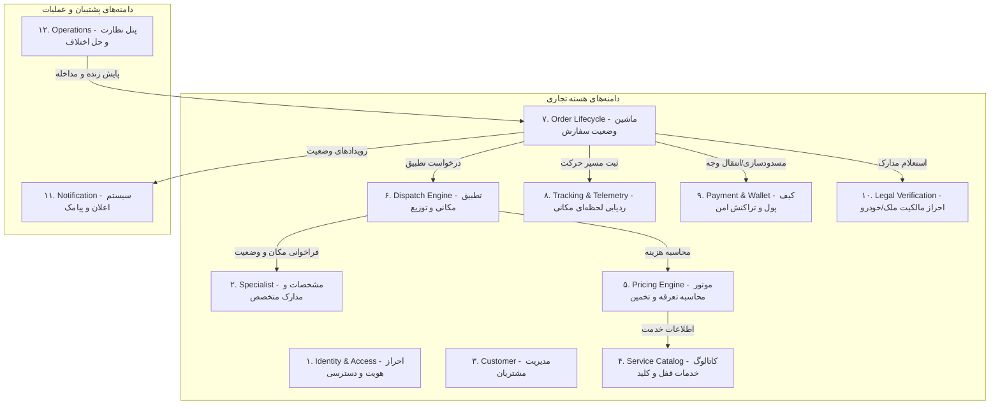

# ماژول‌های دامنه، مرزهای تراکنش و قراردادهای داده (Domain Modules & API Contracts)
**پروژه:** پلتفرم آنلاین خدمات کلیدسازی KeyPro  
**نسخه:** ۱.۰.۰  
**سبک ساختاری:** Modular Monolith بر مبنای معماری دامنه‌محور (Domain-Driven Design)

---

## ۱. نقشه دامنه‌ها و تفکیک ماژول‌ها (Domain Map)

برای جلوگیری از وابستگی‌های متقاطع و حفظ یکپارچگی کدها، سیستم به ۱۲ ماژول مشخص با مسئولیت‌های مجزا تفکیک شده است:



---

## ۲. مشخصات تفصیلی ماژول‌ها (Module Specifications)

### ۲.۱. ماژول احراز هویت و دسترسی (Identity & Access - IAM)
- **مسئولیت:** مدیریت کاربران، ثبت‌نام و ورود بدون رمز با پیامک (OTP)، مدیریت توکن‌های امنیتی Bearer (Laravel Sanctum)، نقش‌ها و مجوزها (RBAC).
- **موجودیت‌های اصلی:** `User`, `Role`, `Permission`, `OtpSession`, `PersonalAccessToken`.
- **خطاهای مورد انتظار:** `OTP_EXPIRED`, `INVALID_CREDENTIALS`, `PHONE_RATE_LIMITED`, `ACCOUNT_SUSPENDED`.

### ۲.۲. ماژول متخصصین (Specialist Domain)
- **مسئولیت:** مدیریت پرونده شغلی کلیدساز، مدارک شناسایی، بارگذاری پروانه کسب و گواهی عدم سوءپیشینه، مهارت‌ها و ابزارها (کلید کامپیوتری، بازگشایی درب ضدسرقت، تراش کلید، کدینگ ریموت خودرو)، وضعیت شیفت (آنلاین/آفلاین/مشغول)، وسیله نقلیه (موتور/وانت/سواری).
- **موجودیت‌های اصلی:** `SpecialistProfile`, `SpecialistSkill`, `SpecialistDocument`, `WorkingZone`.
- **رویدادهای دامنه:** `SpecialistWentOnline`, `SpecialistWentOffline`, `SpecialistKycApproved`.

### ۲.۳. ماژول کاتالوگ خدمات و قیمت‌گذاری (Service Catalog & Dynamic Pricing)
- **مسئولیت:** دسته‌بندی و لیست خدمات (قفل درب، کلید خودرو، ریموت، گاوصندوق، قفل‌های الکترونیکی و بیومتریک)، محاسبه قیمت پویا بر اساس فرمول:
  $$\text{Price} = \text{BaseFee} + (\text{Distance} \times \text{KmRate}) + \text{ToolCost} \times \text{TimeMultiplier} \times \text{TrafficMultiplier}$$
- **موجودیت‌های اصلی:** `ServiceCategory`, `ServiceItem`, `PricingRule`, `SurchargeZone`.

### ۲.۴. ماژول دیسپچ و تطبیق مکانی (Spatial Dispatch Engine)
- **مسئولیت:** یافتن متخصصین واجد شرایط و آنلاین در محدوده ۵ تا ۱۰ کیلومتری مبدأ سفارش با استفاده از توابع PostGIS (`ST_DWithin` و محاسبات مبتنی بر ایندکس GiST)، پخش نوبتی یا عمومی پیشنهاد سفر به متخصصین، مدیریت انقضای زمان پذیرش (Timeouts).
- **قرارداد ورودی:** `(latitude, longitude, service_item_id, max_radius_meters)`.
- **خروجی:** لیست مرتب‌شده متخصصین با تخمین زمان رسیدن بر اساس فاصله هوایی/شبکه.

### ۲.۵. ماژول چرخه حیات سفارش (Order Lifecycle State Machine)
- **مسئولیت:** مدیریت وضعیت سفارش با قوانین غیرقابل بازگشت ماشین وضعیت (State Machine).
- **وضعیت‌های مجاز (State Transitions):**
  1. `DRAFT`: در حال ثبت توسط مشتری.
  2. `BROADCASTING`: در حال ارسال به متخصصان اطراف.
  3. `ACCEPTED`: پذیرفته‌شده توسط کلیدساز.
  4. `EN_ROUTE`: کلیدساز در حرکت به سمت مشتری.
  5. `ARRIVED`: کلیدساز در محل مشتری حاضر شده است.
  6. `IN_PROGRESS`: کار فنی در حال انجام است (احراز هویت مشتری الزامی است).
  7. `PAYMENT_PENDING`: کار پایان یافته و فاکتور نهایی صادر شده است.
  8. `COMPLETED`: تسویه حساب انجام و سفارش مختومه گردید.
  9. `CANCELLED`: لغو توسط مشتری، متخصص یا اپراتور با ثبت دقیق دلیل و جریمه مصوب.

### ۲.۶. ماژول احراز اصالت و بررسی مالکیت قانونی (Legal Verification Domain)
- **مسئولیت حساس و حیاتی:** صنف کلیدسازی به دلیل ماهیت بازگشایی درب‌های قفل‌شده مشمول ضوابط شدید انتظامی است. متخصص موظف است قبل از شروع بازگشایی درب، تصویر کارت ملی و مدرک اثبات سکونت (سند، اجاره‌نامه، قبوض خدماتی) یا کارت ماشین را در وب‌اپ ثبت کرده و مشتری تاییدیه امضای دیجیتال بدهد.
- **موجودیت‌های اصلی:** `OwnershipProof`, `EmergencyVerificationLog`.

### ۲.۷. ماژول کیف پول و پرداخت (Payment & Double-Entry Ledger)
- **مسئولیت:** حساب امانی (Escrow)، کسر کارمزد پلتفرم (مثلاً ۱۵٪)، واریز به حساب بستانکاری متخصص، مدیریت کیف پول مشتری، اتصال به درگاه‌های پرداخت شاپرکی و تسویه پایای بانکی از طریق شبا.
- **موجودیت‌های اصلی:** `Wallet`, `Transaction` (حسابداری دوطرفه: `debit_account_id`, `credit_account_id`, `amount`, `reference_type`), `PayoutBatch`.

---

## ۳. مدل نقش‌ها و ماتریس دسترسی سرورمحور (RBAC Model)

| عنوان نقش (Role) | شرح مسئولیت | سطح دسترسی و قابلیت‌ها |
|---|---|---|
| **Guest** | کاربر مهمان احراز هویت‌نشده | مشاهده کاتالوگ خدمات، نرخ‌نامه مصوب اتحادیه، ثبت شماره تلفن برای دریافت OTP |
| **Customer** | مشتری متقاضی کلیدساز | ثبت سفارش، مشاهده زنده وضعیت متخصص، پرداخت آنلاین، لغو با قوانین، ثبت نظر و امتیاز |
| **Specialist** | متخصص / کلیدساز تأیید صلاحیت‌شده | تعیین وضعیت شیفت، دریافت و قبول سفارش‌های اطراف، به‌روزرسانی وضعیت کار، ثبت مدارک احراز هویت ملک، برداشت از کیف پول |
| **Operator / Dispatcher** | اپراتور دیسپچ و مرکز عملیات | مشاهده نقشه زنده شهر و وضعیت متخصصین، تخصیص دستی سفارش‌های معطل، تماس تلفنی امن با طرفین، پیگیری لغو یا گزارش‌های مشکوک |
| **Finance Officer** | کارشناس مالی و حسابداری | تأیید و صدور فایل تسویه شبای بانکی، گزارش گردش مالی، تنظیم نرخ کارمزدها |
| **System Admin** | مدیر ارشد سامانه | دسترسی کامل، تایید مدارک و جواز کسب متخصصین (KYC)، تغییر ضرایب قیمت‌گذاری، تعریف کاربران و نقش‌ها |

---

## ۴. مرزهای تراکنش و سازگاری داده‌ها (Transaction Boundaries)

1. **قانون اتمیک درون‌ماژولی:** هر عملیاتی که وضعیت یک موجودیت و جدول رویداد آن را تغییر می‌دهد (مانند تغییر وضعیت سفارش از `ACCEPTED` به `EN_ROUTE`) باید درون یک تراکنش استاندارد `DB::transaction()` اجرا گردد.
2. **ارتباطات بین‌ماژولی ناهمگام (Transactional Outbox Pattern):** هنگامی که عملیاتی در یک ماژول پیامدی در ماژول دیگر دارد (مانند اتمام سفارش که منجر به ایجاد سند حسابداری در ماژول پرداخت می‌شود)، رویداد ابتدا در جدول `domain_events` همان تراکنش ذخیره شده و توسط Queue Worker پردازش می‌شود تا در صورت خطای شبکه یا قطعی موقت سرویس ثانویه، مغایرت داده ایجاد نشود.

---

## ۵. استاندارد پاسخ‌های API (Unified API Response Format)

تمام درخواست‌های RESTful از فرمت استاندارد زیر پیروی می‌کنند:

### پاسخ موفق (Success):
```json
{
  "success": true,
  "data": { ... },
  "message": "عملیات با موفقیت انجام شد",
  "meta": {
    "timestamp": 1728955200,
    "version": "v1"
  }
}
```

### پاسخ خطا (Error):
```json
{
  "success": false,
  "error": {
    "code": "SPECIALIST_NOT_AVAILABLE",
    "message": "متخصص انتخابی در دسترس نیست یا سفارش دیگری را پذیرفته است.",
    "details": []
  },
  "meta": {
    "timestamp": 1728955200
  }
}
```
