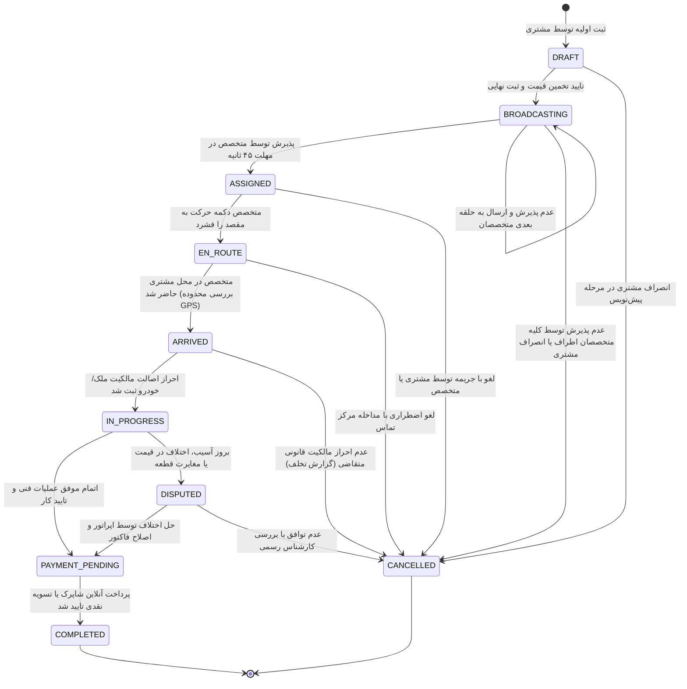

# ماشین وضعیت سفارش و قوانین انتقال مجاز (Order Lifecycle State Machine)
**پروژه:** سامانه آنلاین کلیدسازی KeyPro  
**نسخه:** ۱.۰.۰  
**وضعیت:** مصوب فاز صفر  

---

## ۱. دیاگرام ماشین وضعیت (State Machine Diagram)

---

## ۲. ماتریس انتقال وضعیت‌ها و قوانین تجاری (Transition Rules Matrix)

| وضعیت مبدأ | رویداد / اکشن (Event) | وضعیت مقصد | بازیگر مجاز (Trigger Actor) | پیش‌شرط‌ها و قوانین الزامی (Business Constraints) |
|---|---|---|---|---|
| `DRAFT` | `SubmitBooking` | `BROADCASTING` | مشتری | انتخاب نقطه معتبر روی نقشه و تایید بازه برآورد قیمت. |
| `DRAFT` | `DiscardDraft` | `CANCELLED` | مشتری | لغو بدون جریمه. |
| `BROADCASTING` | `AcceptOffer` | `ASSIGNED` | متخصص | پذیرش ظرف مهلت زمانی معین (Time-to-Accept = 45s)؛ قفل شدن همزمان متخصص برای سایر سفارش‌ها. |
| `BROADCASTING` | `BroadcastTimeout` | `CANCELLED` / `MANUAL` | سیستم | در صورت عدم پاسخ پس از ۳ چرخه، به صف اعزام دستی اپراتور منتقل می‌شود. |
| `ASSIGNED` | `StartRoute` | `EN_ROUTE` | متخصص | ارسال تله‌متری اولیه مکانی متخصص. |
| `ASSIGNED` | `CancelAssigned` | `CANCELLED` | مشتری / متخصص | در صورت لغو پس از ۳ دقیقه توسط مشتری، هزینه کنسلی پایه محاسبه می‌شود. |
| `EN_ROUTE` | `ReportArrival` | `ARRIVED` | متخصص | بررسی انطباق مختصات GPS متخصص با مبدأ سفر (شعاع ۲۰۰ متری). |
| `ARRIVED` | `VerifyAndStart` | `IN_PROGRESS` | متخصص | **الزام انتظامی:** بارگذاری عکس مدارک مالکیتی (کارت ملی، سند یا اجاره‌نامه یا کارت خودرو) و تایید امضای مشتری. |
| `ARRIVED` | `FailVerification` | `CANCELLED` | متخصص | گزارش رسمی عدم احراز هویت متقاضی؛ لغو امن جهت جلوگیری از مشارکت در سرقت. |
| `IN_PROGRESS` | `FinishWork` | `PAYMENT_PENDING` | متخصص | ثبت ریز قطعات مصرفی و درخواست تایید از مشتری. |
| `IN_PROGRESS` | `RaiseDispute` | `DISPUTED` | مشتری / متخصص | ثبت گزارش مغایرت هزینه یا صدمه به قفل. |
| `DISPUTED` | `ResolveDispute` | `PAYMENT_PENDING` | اپراتور | مداخله مرکز تماس و اصلاح مبلغ نهایی فاکتور. |
| `PAYMENT_PENDING` | `ConfirmPayment` | `COMPLETED` | درگاه بانکی / مشتری | تایید وریفای شاپرک یا تایید دریافت وجه نقد توسط کلیدساز. |

---

## ۳. فرآیند تغییر محدوده کار در محل (Scope Change Approval Lifecycle)

در خدمات قفل و کلید، بسیار رایج است که پس از باز کردن روکش درب، مشخص شود قفل نیازمند تعویض سیلندر ضدسرقت، نصب حفاظ ایمنی یا تعویض توپی شکسته است:

1. **پیشنهاد کارشناس (`Technician Proposes`):** متخصص در وضعیت `IN_PROGRESS` آیتم‌های الحاقی و قیمت قطعه را از کاتالوگ یا به صورت کارشناسی در اپ ثبت می‌کند.
2. **ارسال هشدار به مشتری (`Customer Prompted`):** وب‌اپلیکیشن مشتری بلافاصله مبلغ مازاد، دلیل فنی و گارانتی قطعه را نمایش می‌دهد.
3. **تایید مشتری (`Customer Approves`):** با ثبت تاییدیه دیجیتال توسط مشتری، مبلغ فاکتور نهایی به‌روزرسانی می‌شود.
4. **رد توسط مشتری (`Customer Rejects`):** کار صرفاً در محدوده اولیه بازگشایی درب ادامه یافته و هیچ هزینه مازادی در فاکتور درج نخواهد شد.
