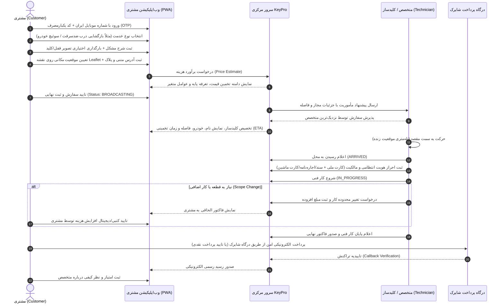
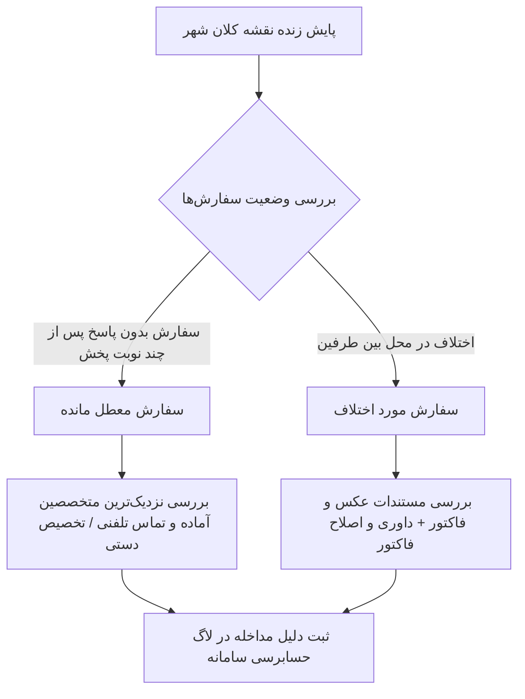

# جریان‌های کامل کاربری و تعاملات نقشی (Comprehensive User Journeys)
**پروژه:** پلتفرم آنلاین خدمات کلیدسازی KeyPro (بر پایه مدل عملیاتی LockAtlas، بومی‌سازی‌شده برای ایران)  
**نسخه:** ۱.۰.۰  
**وضعیت:** مصوب فاز صفر  

---

## ۱. جریان کاربری مشتری (Customer Journey)

---

## ۲. جریان کاربری متخصص / کلیدساز (Technician Journey)

1. **ثبت‌نام و ورود:** ورود با شماره موبایل و احراز هویت پیامکی.
2. **ارسال مدارک (KYC):** بارگذاری تصویر کارت ملی، شناسنامه، پروانه کسب معتبر از اتحادیه صنف کلیدسازان، و گواهی عدم سوءپیشینه کیفری.
3. **تعیین مهارت‌ها و تجهیزات:** انتخاب تخصص‌ها (قفل‌های دیجیتال و اثر انگشتی، گاوصندوق‌های رمزی، کدینگ ریموت خودرو، کلیدهای کامپیوتری) و وسیله نقلیه (موتورسیکلت یا خودرو مجهز به دستگاه تراش کلید سیار).
4. **شروع شیفت کاری:** تغییر وضعیت به "آماده‌به‌کار / آنلاین" در محدوده جغرافیایی مجاز.
5. **دریافت و بررسی مأموریت:** مشاهده کارت پیشنهاد حاوی نوع خدمت، تصویر قفل، محدوده تقریبی مشتری، مسافت و مبلغ تضمین‌شده.
6. **پذیرش مأموریت:** کلیک روی دکمه پذیرش ظرف ۴۵ ثانیه.
7. **مسیریابی و حضور:** استفاده از نقشه آفلاین/آنلاین جهت حضور در موقعیت مشتری و اعلام وضعیت `ARRIVED`.
8. **فرآیند الزامی انتظامی احراز اصالت:** عکس‌برداری از مدارک مالکیتی متقاضی (سند، اجاره‌نامه هولوگرام‌دار، قبوض خدماتی یا کارت خودرو) و اخذ امضای رضایت دیجیتال مشتری.
9. **انجام خدمت و تغییر محدوده:** اجرای کار فنی؛ در صورت نیاز به مغزی جدید یا قفل برقی، ارسال پیشنهاد `Scope Change` و انتظار برای تایید مشتری.
10. **پایان کار و تسویه:** تحویل کلید سالم، دریافت کد تایید پایان کار از مشتری، مشاهده واریز سهم در کیف پول داخلی، و ثبت درخواست تسویه پایا به شماره شبا.

---

## ۳. جریان اپراتور و دیسپچ (Operations & Dispatch Journey)

---

## ۴. جریان کارشناس مالی و حسابداری (Finance Officer Journey)

1. **مانیتورینگ درگاه‌ها:** بررسی ورودی‌های درگاه پرداخت شاپرک و تطبیق فایل‌های مغایرت بانکی روزانه.
2. **نظارت بر دفتر کل دوطرفه (Double-Entry Ledger):** کنترل تراز بدهکار/بستانکار حساب‌های واسط امانی، درآمد کارمزد پلتفرم و مطالبات متخصصان.
3. **مدیریت درخواست‌های تسویه شبا:** استعلام خودکار تطابق نام و نام خانوادگی صاحب شبا با هویت ثبت‌شده کلیدساز، تایید دسته‌ای (Batch Approval) و صدور فایل استاندارد پایا/ساتنا برای انتقال وجه.
4. **حسابرسی لغو و استرداد وجه:** رسیدگی به سفارش‌های لغو شده و انجام فرآیند استرداد به کارت مبدأ مشتری طبق ضوابط جریمه لغو.

---

## ۵. جریان مدیر ارشد سامانه (System Administrator Journey)

1. **بررسی و تصویب صلاحیت متخصصان (KYC):** انطباق پروانه کسب با استعلام‌های صنفی و فعال‌سازی دسترسی کلیدساز.
2. **مدیریت کاتالوگ خدمات و تعرفه‌ها:** تعریف تعرفه‌های پایه، تنظیم ضرایب شبانه (ساعت ۲۲ الی ۶ صبح)، ضرایب شرایط بد آب و هوایی و مناطق پرترافیک شهری.
3. **تنظیمات زیرساخت و امنیت:** پایش لاگ‌های امنیتی (Audit Logs)، تلاش‌های ناموفق ورود، تغییر سطوح دسترسی (RBAC)، کنترل سهم کارمزد پلتفرم و مانیتورینگ سلامت سرویس‌ها.
