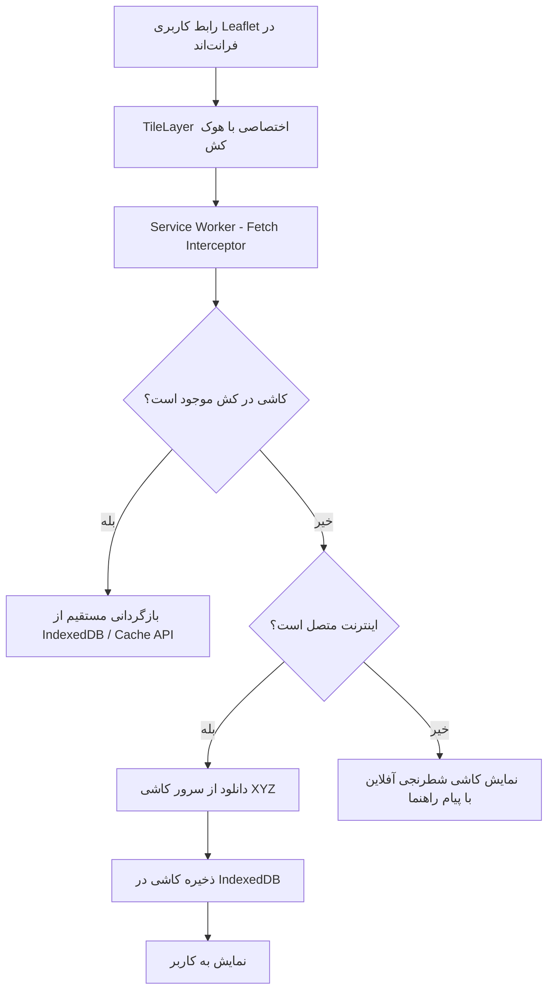

# استراتژی نقشه، معماری کاشی‌های آفلاین و تحلیل واقع‌بینانه محدودیت‌های مکانی و ارتباطی
**پروژه:** سامانه آنلاین کلیدسازی KeyPro  
**نسخه:** ۱.۰.۰  
**نقش‌های فنی:** GIS Engineer, Senior Frontend Developer, QA Engineer  

---

## ۱. اهداف و رویکرد کلی زیرساخت نقشه

نقشه هسته اصلی تجربه کاربری در تعیین موقعیت اضطراری مشتری، ردیابی حرکت کلیدساز، تعیین هزینه سفر و بررسی حوزه‌های خدمات شهری است. هدف فنی ما دستیابی به سیستمی است که:
1. نیازمند هیچ کلید API تجاری یا انحصاری (مانند گوگل مپس یا سرویس‌های پولی) نباشد.
2. با شرایط اینترنت ضعیف یا ناپایدار در کوچه و خیابان‌های شهری سازگار باشد.
3. دارای امکان بسته‌بندی و کش آفلاین نقشه‌های کلان‌شهرها باشد.
4. هیچ ادعای غیرعلمی، بازاریابی دروغین یا فرضیات فانتزی درباره کارکرد تجهیزات در زمان قطعی کامل اینترنت نداشته باشد.

---

## ۲. مشخصات لایسنس و حقوق مالکیت معنوی داده‌های نقشه (OSM License Compliance)

- **منبع داده‌های پایه:** پروژه بین‌المللی **OpenStreetMap (OSM)**.
- **مجوز استفاده (License):** لایسنس پایگاه داده باز (Open Database License - ODbL).
- **حقوق و شروط الزامی:**
  - درج برچسب کپی‌رایت مشهود در گوشه پایین نقشه: `© OpenStreetMap contributors`.
  - عدم نقض سیاست‌های مصرف سرورهای کاشی عمومی (Tile Usage Policy): سرورهای اصلی OSM برای دانلود انبوه کاشی‌های آفلاین مجاز نیستند؛ بنابراین برای بسته‌های آفلاین از خروجی‌های تبدیل‌شده وکتوری یا سرورهای کاشی‌ساز اختصاصی با کش مبتنی بر پروکسی داخلی استفاده می‌شود.

---

## ۳. معماری فنی کش آفلاین کاشی‌های نقشه (Offline Tile Architecture)

### مشخصات بسته‌های کاشی از پیش دانلودشده (Pre-packaged City Maps):
برای هر کلان‌شهر (مثلاً تهران، مشهد، اصفهان):
- **محدوده پوشش (Bounding Box):** مختصات جغرافیایی شمال‌غرب و جنوب‌شرق محدوده شهری.
- **سطوح زوم (Zoom Levels):**
  - زوم‌های کلی (Zoom 11 تا 13): برای نمای کلان شهر و اتوبان‌ها.
  - زوم‌های دقیق محله‌ای (Zoom 14 تا 16): برای مشاهده خیابان‌های اصلی، فرعی‌ها و کوچه‌ها.
  - از زوم‌های بالاتر از ۱۶ در بسته آفلاین به دلیل رشد تصاعدی حجم خودداری می‌شود (حفظ حجم بسته زیر ۴۰ مگابایت برای هر شهر).
- **محل ذخیره‌سازی کلاینت:** پایگاه داده محلی مرورگر (**IndexedDB**) با استفاده از کتابخانه `leaflet.offline` که امکان استعلام سریع بدون قفل کردن حافظه اصلی تب را فراهم می‌کند.

---

## ۴. تفکیک علمی و واقع‌بینانه قابلیت‌های آفلاین در برابر آنلاین

صداقت مهندسی حکم می‌کند که مرزهای فیزیکی تکنولوژی شفاف باشند. جدول زیر ماتریس توانایی‌ها در قطعی اینترنت را نشان می‌دهد:

| قابلیت سامانه | وضعیت در قطعی اینترنت | امکان‌پذیری فنی و چرایی | رفتار سیستم و راهکار جایگزین (Graceful Degradation) |
|---|---|---|---|
| **دریافت مختصات GPS گوشی** | **کار می‌کند** (با تاخیر اولیه) | چیپ سخت‌افزاری GPS در تلفن همراه مستقیماً با امواج ماهواره‌ای کار می‌کند و به اینترنت وابسته نیست؛ هرچند بدون داده تلفن همراه، قابلیت A-GPS (کمک‌رسان برج‌های مخابراتی) کار نکرده و پیدا کردن ماهواره در نقاط سرپوشیده زمان بیشتری می‌برد. | نمایش دایره دقت مکان کاربر روی نقشه آفلاین بر اساس آخرین نقطه دریافت‌شده از سنسور سخت‌افزاری. |
| **نمایش نقشه و لایه‌های گرافیکی** | **کار می‌کند** (در محدوده ذخیره‌شده) | اگر کاربر قبلاً نقشه شهر را باز کرده باشد یا بسته آفلاین را دانلود کرده باشد، کاشی‌ها از IndexedDB خوانده شده و نمایش داده می‌شوند. | در صورت خروج کاربر از محدوده ذخیره‌شده، لایه گرافیکی تیره با آیکون راهنمای دانلود محدوده جدید نشان داده می‌شود. |
| **ارسال موقعیت مکانی زنده متخصص به سرور** | **غیرممکن است** | مختصات GPS در دستگاه تولید می‌شود اما برای انتقال به سرور و نمایش به مشتری نیازمند حامل شبکه (GPRS/LTE/Wi-Fi) است. در غیاب امواج رادیویی شبکه، هیچ پروتکل جادویی وجود ندارد. | اپلیکیشن متخصص مختصات را در صف محلی (Local Queue) ثبت کرده و به محض برقراری اتصال به صورت دسته‌ای (Batch) با متادیتا ارسال می‌کند. وضعیت در رابط کاربری به عنوان "اتصال معلق / ردیابی محلی" علامت‌گذاری می‌شود. |
| **ثبت سفارش جدید توسط مشتری** | **غیرممکن است** | پیدا کردن کلیدساز نیازمند سرور مرکزی، محاسبات فاصله PostGIS، و اطلاع‌رسانی به گوشی کلیدسازان دیگر است. | سیستم پیام واضحی می‌دهد: "اتصال اینترنت قطع است. برای درخواست فوری کلیدساز با شماره تلفن چهاررقمی مرکز تماس ۲۴ ساعته تماس بگیرید." و یک دکمه تک‌کلیکه تماس تلفنی فعال می‌گردد (`tel:021xxxx`). |
| **مشاهده اطلاعات سفر فعال** | **کار می‌کند** | آخرین اطلاعات تاییدشده سفر (مشخصات کلیدساز، پلاک موتورسیکلت/خودرو، تلفن، نوع خدمت توافق‌شده) در `localStorage` و `IndexedDB` موجود است. | صفحه سفارش باز مانده و شماره تلفن کلیدساز جهت برقراری تماس صوتی سلولار فعال است. |
| **پرداخت آنلاین شاپرک** | **غیرممکن است** | هدایت به درگاه بانکی شاپرک منحصراً نیازمند دسترسی به شبکه اینترنت سراسری یا شبکه ملی اطلاعات است. | قابلیت تغییر روش پرداخت به "پرداخت نقدی / کارت به کارت در محل پس از پایان کار" به عنوان گزینه جایگزین ارائه می‌گردد. |
| **ارسال پیامک تایید هویت (OTP)** | **غیرممکن است** | برای دریافت پیامک روی گوشی، شبکه GSM تلفن همراه لازم است اما سمت سرور ما نیز برای فراخوانی API پیامکی نیازمند اینترنت است. | پیام خطای عدم برقراری ارتباط با درگاه پیامک و راهنمایی ورود از طریق کدهای پشتیبان از پیش صادرشده. |

---

## ۵. شاخص‌های وضعیت اتصال در رابط کاربری (Network Indicators)

برای عدم سردرگمی کاربر، نوار وضعیت شبکه در بالای تمام صفحات فرانت‌اند تعبیه می‌گردد:
1. **سبز (آنلاین - پایدار):** وب‌سوکت متصل، اینترنت نرمال، ردیابی زنده فعال.
2. **زرد (ناپایدار / در حال تلاش مجدد):** ارتباط سوکت قطع، استفاده موقت از Polling، هشدار تاخیر در ردیابی.
3. **قرمز (آفلاین کامل):** نمایش بنر شفاف "حالت آفلاین فعال است - برخی امکانات آنلاین موقتاً در دسترس نیستند"، هدایت به شماره تماس صوتی اضطراری.
