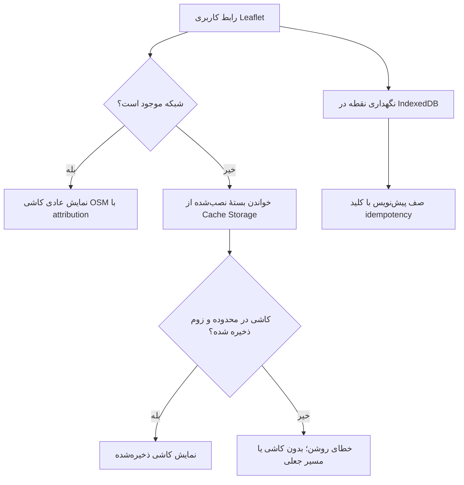

# استراتژی نقشه، معماری کاشی‌های آفلاین و تحلیل واقع‌بینانه محدودیت‌های مکانی و ارتباطی
**پروژه:** سامانه آنلاین کلیدسازی KeyPro  
**نسخه:** ۱.۰.۰  
**نقش‌های فنی:** GIS Engineer, Senior Frontend Developer, QA Engineer  

---

## ۱. اهداف و رویکرد کلی زیرساخت نقشه

نقشه هسته اصلی تجربه کاربری در تعیین موقعیت اضطراری مشتری، ردیابی حرکت کلیدساز، تعیین هزینه سفر و بررسی حوزه‌های خدمات شهری است. هدف فنی ما دستیابی به سیستمی است که:
1. نیازمند هیچ کلید API تجاری یا انحصاری (مانند گوگل مپس یا سرویس‌های پولی) نباشد.
2. با شرایط اینترنت ضعیف یا ناپایدار در کوچه و خیابان‌های شهری سازگار باشد.
3. دارای امکان بسته‌بندی و کش آفلاین نقشه‌های کلان‌شهرها باشد.
4. هیچ ادعای غیرعلمی، بازاریابی دروغین یا فرضیات فانتزی درباره کارکرد تجهیزات در زمان قطعی کامل اینترنت نداشته باشد.

---

## ۲. مشخصات لایسنس و حقوق مالکیت معنوی داده‌های نقشه (OSM License Compliance)

- **منابع شرایط استفاده:** [سیاست استفاده از کاشی‌های OSM](https://operations.osmfoundation.org/policies/tiles/)، [سیاست استفاده از Nominatim](https://operations.osmfoundation.org/policies/nominatim/) و [متن مجوز ODbL](https://opendatacommons.org/licenses/odbl/).
- **نقشهٔ آنلاین:** کاشی‌های استاندارد `tile.openstreetmap.org` با attribution قابل‌مشاهده؛ فقط درخواست‌های عادی نمایش نقشه.
- **بستهٔ آفلاین:** فقط رسترهای تأمین‌شده از توزیع‌کننده‌ای که اجازهٔ بازتوزیع آن‌ها را مستند کرده باشد. داشتن مجوز ODbL برای دادهٔ پایه، به‌تنهایی مجوز بازتوزیع کاشی‌های رندرشده یا سبک نقشه نیست.
- **مجوز استفاده (License):** لایسنس پایگاه داده باز (Open Database License - ODbL).
- **حقوق و شروط الزامی:**
  - درج برچسب کپی‌رایت مشهود در گوشه پایین نقشه: `© OpenStreetMap contributors`.
  - سرور عمومی کاشی OSM برای دانلود انبوه، پیش‌واکشی یا ساخت بستهٔ آفلاین استفاده نمی‌شود. لایهٔ آنلاین نیز در Service Worker کش نمی‌شود.
  - بستهٔ آفلاین باید مجوز بازتوزیع کاشی رندرشده، attribution و مدرک مجوز تأمین‌کننده داشته باشد. انتشار بسته بدون بررسی انسانی و حقوقی مجاز نیست.

---

## ۳. معماری فنی کش آفلاین کاشی‌های نقشه (Offline Tile Architecture)

### مشخصات بسته‌های کاشی از پیش دانلودشده (Pre-packaged City Maps):
برای هر کلان‌شهر (مثلاً تهران، مشهد، اصفهان):
- **محدوده پوشش (Bounding Box):** مختصات جغرافیایی شمال‌غرب و جنوب‌شرق محدوده شهری.
- **سطوح زوم (Zoom Levels):**
  - زوم‌های کلی (Zoom 11 تا 13): برای نمای کلان شهر و اتوبان‌ها.
  - زوم‌های دقیق محله‌ای (Zoom 14 تا 16): برای مشاهده خیابان‌های اصلی، فرعی‌ها و کوچه‌ها.
  - از زوم‌های بالاتر از ۱۶ در بسته آفلاین به دلیل رشد تصاعدی حجم خودداری می‌شود (حفظ حجم بسته زیر ۴۰ مگابایت برای هر شهر).
- **محل ذخیره‌سازی کلاینت:** فایل کاشی‌ها در Cache Storage؛ فراداده و نقطه‌های ذخیره‌شده در IndexedDB. هر کاشی و index با SHA-256 بررسی می‌شود.
- **اعتبار داده:** `dataUpdatedAt` و `validUntil` بخشی از catalog هستند. بستهٔ منقضی قابل نصب نیست و کاشی‌های منقضی در حالت آفلاین استفاده نمی‌شوند.
- **محدودیت نصب:** حداکثر ۴۰ MiB و ۵۰٬۰۰۰ کاشی در هر بسته و بررسی سهمیهٔ فضای دستگاه پیش از نصب.

### تأمین و انتشار بسته

بسته از دادهٔ آمادهٔ تأمین‌کنندهٔ مجاز ساخته می‌شود؛ اسکریپت هیچ کاشی‌ای از اینترنت دریافت یا scrape نمی‌کند:

1. از تأمین‌کننده، فایل‌های رستر `tiles/<z>/<x>/<y>.png|webp|jpg` و مجوز صریح توزیع مجدد همان کاشی‌ها دریافت کنید. شواهد مجوز را در فایل محلی `LICENSE-EVIDENCE.txt` نگه دارید.
2. کنار پوشهٔ `tiles` یک `source.json` بسازید که شامل `id`, `name`, `regionLabel`, `centerLat`, `centerLng`, `boundsSW`, `boundsNE`, `zoomMin`, `zoomMax`, `version`, `source`, `sourceUrl`, `license`, `licenseUrl`, `attribution`, `distributionAuthorized: true`, `evidenceFile`, `dataUpdatedAt` و `validUntil` باشد. `license` فعلاً باید `ODbL-1.0` و `attribution` شامل `OpenStreetMap contributors` باشد.
3. این فرمان را اجرا کنید: `npm run maps:package -- --source <licensed-bundle> --output public/offline-maps`.
4. ابزار روی HTTPS، منبع مجاز (و رد صریح دامنهٔ کاشی عمومی OSM)، شواهد مجوز، فرمت و محدودهٔ کاشی، تکراری نبودن مختصات، سقف تعداد/حجم، نسخهٔ جدید، تاریخ اعتبار و checksumها کنترل انجام می‌دهد. `catalog.json` و index نسخه‌دار فقط پس از ساخت کامل منتشر می‌شوند.
5. برای به‌روزرسانی، نسخه را افزایش دهید؛ نسخهٔ منتشرشده بازنویسی نمی‌شود. پیش از انتشار، مالک داده باید مجوز و attribution را با منبع اصلی بازبینی کند. فایل شواهد محلی در خروجی عمومی کپی نمی‌شود.

این مخزن دادهٔ واقعی بستهٔ شهری یا مدرک مجوز توزیع‌کننده ندارد؛ بنابراین در میزبان بدون `public/offline-maps/catalog.json`، بسته‌ای نمایش داده یا جعل نمی‌شود و نقشهٔ آفلاین تنها پس از تأمین و انتشار قانونی داده در دسترس خواهد بود.

جست‌وجوی محدوده/مکان عمومی به‌صورت دستی و فقط پس از رضایت کاربر انجام می‌شود؛ جست‌وجوی نشانی منزل یا دادهٔ شخصی به Nominatim عمومی ممنوع است. API احراز هویت‌شدهٔ KeyPro نتیجه را ۳۰ روز cache می‌کند، برای کل سامانه حداقل یک ثانیه بین درخواست‌های cache-miss فاصله می‌گذارد و `User-Agent`/`Referer` شناسایی‌کننده می‌فرستد. تکمیل خودکار یا ارسال دوره‌ای وجود ندارد. سرویس سازگار را می‌توان با `NOMINATIM_SEARCH_URL` عوض کرد، بدون تغییر کد یا انتشار frontend.

---

## ۴. تفکیک علمی و واقع‌بینانه قابلیت‌های آفلاین در برابر آنلاین

صداقت مهندسی حکم می‌کند که مرزهای فیزیکی تکنولوژی شفاف باشند. جدول زیر ماتریس توانایی‌ها در قطعی اینترنت را نشان می‌دهد:

| قابلیت سامانه | وضعیت در قطعی اینترنت | امکان‌پذیری فنی و چرایی | رفتار سیستم و راهکار جایگزین (Graceful Degradation) |
|---|---|---|---|
| **مکان‌یابی دستگاه** | وابسته به دستگاه و مرورگر | API مرورگر فقط مختصات و دقت تخمینی را می‌دهد و تضمین نمی‌کند منبع آن GPS ماهواره‌ای باشد؛ ممکن است Wi‑Fi یا شبکهٔ همراه دخیل باشد. درخواست فقط پس از کلیک و اجازهٔ کاربر انجام می‌شود. | روش انتخاب (مرورگر، جست‌وجو، کلیک یا ورود دستی) و دقت گزارش‌شده مشخص می‌شود. |
| **نمایش نقشه و لایه‌های گرافیکی** | **کار می‌کند** (فقط با بستهٔ معتبر و در محدوده ذخیره‌شده) | کاشی‌های بسته از Cache Storage خوانده می‌شوند؛ انتخاب مختصات در IndexedDB است. | خارج از محدوده/زوم بسته، خطای صریح نمایش داده می‌شود و کاشی یا مسیر جایگزین ساخته نمی‌شود. |
| **ارسال موقعیت مکانی زنده متخصص به سرور** | **غیرممکن است** | مختصات GPS در دستگاه تولید می‌شود اما برای انتقال به سرور نیازمند شبکه است. | در این PWA هیچ صف آفلاین برای ردیابی زندهٔ متخصص ادعا یا فعال نمی‌شود. |
| **ایجاد/اعزام سفارش جدید** | **غیرممکن است** | ایجاد سفارش واقعی و اعزام به API آنلاین نیاز دارد. پیش‌نویس محلی فقط پس از اتصال و احراز هویت با کلید idempotency به رکورد همگام‌سازی سرور تبدیل می‌شود و به‌تنهایی سفارش یا اعزام ایجاد نمی‌کند. | مختصات و متن پیش‌نویس محلی می‌مانند؛ پاسخ 409 به‌عنوان تعارض متوقف می‌شود؛ retry همان کلید رکورد تکراری نمی‌سازد. پس از هفت روز، دادهٔ صف سرور و دادهٔ محلی منقضی و پاک می‌شوند. |
| **مشاهده اطلاعات سفر فعال** | وابسته به آنلاین بودن | اطلاعات خصوصی سفارش‌ها و سفرها در کش عمومی Service Worker ذخیره نمی‌شوند. | برای مشاهدهٔ وضعیت و اطلاعات سفارش، اتصال سرور لازم است. |
| **پرداخت آنلاین** | **غیرممکن است** | ایجاد یا تایید پرداخت به سرور و درگاه معتبر نیازمند اتصال است. | هیچ پرداختی در حالت آفلاین تاییدشده نمایش داده نمی‌شود. |
| **ارسال پیامک تایید هویت (OTP)** | **غیرممکن است** | دریافت OTP و ارسال درخواست آن به سرور نیازمند شبکهٔ موبایل/اینترنت است. | پیام خطای اتصال نمایش داده می‌شود؛ هیچ کد پشتیبان یا دورزدنی ادعا نمی‌شود. |

---

## ۵. شاخص‌های وضعیت اتصال در رابط کاربری (Network Indicators)

نوار وضعیت سراسری فقط وضعیت آنلاین/آفلاین مرورگر را نشان می‌دهد؛ آنلاین بودن دستگاه تضمین‌کنندهٔ دسترسی پایدار به سرور نیست. هیچ وضعیت وب‌سوکت، ردیابی زنده یا کانال تماس اضطراری از این نشانگر نتیجه‌گیری نمی‌شود.

## ۶. PWA، ذخیره‌سازی محدود و پشتیبانی مرورگرها

- Service Worker فقط manifest، آیکون‌ها، صفحهٔ آفلاین و فایل‌های asset نسخه‌دار عمومی را cache می‌کند. HTML صفحهٔ Laravel (به‌دلیل کوکی نشست و هدر `private`)، درخواست‌های `/api`، صفحات مسیریابی‌شده و پاسخ‌های دارای `private` یا `no-store` cache نمی‌شوند. در قطعی شبکه navigation به صفحهٔ آفلاین عمومی می‌رود؛ cacheهای مستقل کاشی نقشه حفظ می‌شوند.
- پیش‌نویس و مختصات در IndexedDB ذخیره می‌شوند: پیش‌نویس ۷ روز، آخرین نقطهٔ انتخاب‌شده ۲۴ ساعت و نقاط نام‌گذاری‌شده ۳۰ روز. دادهٔ پیش‌نویس همگام‌شده در سرور حداکثر ۷ روز نگهداری می‌شود و پاک‌سازی زمان‌بندی‌شده دارد. کاربر می‌تواند دادهٔ محلی را زودتر حذف کند.
- iOS: نصب از Safari و «Add to Home Screen» در نسخه‌های پشتیبان؛ سهمیه و ماندگاری storage تابع سیاست سیستم است و ممکن است در فشار فضای ذخیره‌سازی پاک شود. اجرای پس‌زمینه، Background Sync و اعلان Push به نسخهٔ iOS، روش نصب و مجوز کاربر وابسته‌اند؛ همگام‌سازی تضمینی پس‌زمینه ارائه نمی‌شود.
- Android: نصب و Service Worker در مرورگرهای Chromium پشتیبانی‌شده معمولاً کامل‌تر است؛ مجوز اعلان، محدودیت باتری، پاک‌شدن دادهٔ مرورگر و قابلیت Background Sync همچنان وابسته به مرورگر/سیستم هستند.
- دسکتاپ: نصب در مرورگرهای پشتیبان و Service Worker در origin امن ممکن است؛ اعلان، مکان‌یابی، مجوزها و اجرای پس‌زمینه وابسته به مرورگر و تنظیمات سیستم هستند.
- در هر سه گروه، ثبت محلی صرفاً ذخیرهٔ پیش‌نویس است؛ به معنی سفارش واقعی، پرداخت، اعزام متخصص یا تضمین همگام‌سازی در پس‌زمینه نیست. همگام‌سازی پس از اتصال، بازگشت صفحه به foreground یا ورود انجام می‌شود.
