# نقشه راه فازبندی پروژه و معیارهای پذیرش قطعی (Phase Acceptance & Roadmap)
**پروژه:** سامانه جامع درخواست خدمات کلیدسازی KeyPro  
**نسخه سند:** ۱.۰.۰  
**اصل کلیدی:** اجرای تک‌فاز، بدون هم‌پوشانی ناقص، اثبات آزمون‌ها پیش از صدور مجوز ورود به فاز بعد (قاعده PASS یا BLOCKED).

---

## ۱. جدول ماتریس فازهای پروژه

```mermaid
graph LR
    P0[فاز صفر: شناخت، ارزیابی محیط و تثبیت معماری] --> P1[فاز یک: زیرساخت لاراول، دیتابیس PostGIS و اسکلت ماژولار]
    P1 --> P2[فاز دو: ماژول هویت، OTP، سطوح دسترسی و KYC متخصص]
    P2 --> P3[فاز سه: کاتالوگ خدمات، موتور مکانی PostGIS و تخمین قیمت]
    P3 --> P4[فاز چهار: ماشین وضعیت سفارش، دیسپچ زنده و تله‌متری]
    P4 --> P5[فاز پنج: درگاه پرداخت، کیف پول دوطرفه و حساب امانی]
    P5 --> P6[فاز شش: فرانت‌اند PWA، رابط کاربری لوکس فارسی، Leaflet و کش آفلاین]
    P6 --> P7[فاز هفت: تست‌های خودکار سراسری، امنیت و کارایی]
    P7 --> P8[فاز هشت: استقرار کانتینری Docker، پایش و آماده‌سازی Production]
```

---

## ۲. مشخصات و معیارهای پذیرش تفکیکی هر فاز

---

### فاز صفر: شناخت محیط، ارزیابی ابزارها و تثبیت معماری (Phase 0 - جاری)
- **شرح فعالیت:** بررسی عینی سیستم‌عامل، نسخه‌های واقعی ابزارها، ایجاد مخزن Git، تدوین مستندات معماری کلان، ADRها، تفکیک دامنه‌ها، مدل‌سازی تهدیدات و استراتژی نقشه و آفلاین.
- **خروجی‌های الزامی:**
  - `docs/environment/environment-assessment.md`
  - `docs/architecture/system-overview.md`
  - `docs/architecture/adr/` (ADR-001 تا ADR-008 و index.md)
  - `docs/architecture/domain-modules.md`
  - `docs/security/threat-model.md`
  - `docs/maps/offline-strategy.md`
  - `docs/roadmap/phase-acceptance.md`
- **معیار پذیرش قطعی (Pass Criteria):**
  - ابزارهای محلی با خروجی واقعی اثبات شده باشند (عدم وجود فرضیات فرضی).
  - تمام ADRهای هشت‌گانه با جزییات کامل ثبت شده باشند.
  - هیچ کدی از منطق تجاری یا فرانت‌اند هنوز تولید نشده باشد.
  - گزارش ارزیابی با وضعیت شفاف اعلام گردد.

---

### فاز یک: زیرساخت اسکلت لاراول، دیتابیس PostGIS و ساختار ماژولار (Phase 1)
- **شرح فعالیت:** راه‌اندازی پروژه استاندارد Laravel 11، تنظیم فایل پیکربندی داکر (`docker-compose.yml`) شامل PostgreSQL 16 و PostGIS 3.4، پیاده‌سازی زیرساخت ماژولار (`app/Modules/`)، تنظیم میگریشن‌های اولیه و کلاس‌های پایه DTO و Service Interface.
- **خروجی‌های الزامی:**
  - کدهای هسته Laravel 11 و پوشه‌بندی دامنه‌ها.
  - فایل `docker-compose.yml` و فایل‌های پیکربندی محیطی `.env.example`.
  - میگریشن فعال‌سازی اکستنشن مکانی `CREATE EXTENSION IF NOT EXISTS postgis;`.
  - اجرای موفق `php artisan migrate`.
- **معیار پذیرش قطعی:** اجرای بدون خطای کامندهای دیتابیس و تست اتصال به پایگاه داده با خروجی موفق در محیط محلی یا داکر.

---

### فاز دو: احراز هویت، پیامک OTP، مجوزهای RBAC و مدارک متخصصین (Phase 2)
- **شرح فعالیت:** پیاده‌سازی سیستم ورود/ثبت‌نام دوطرفه با پیامک (OTP)، توکن‌های Sanctum، سیستم کنترل دسترسی نقشی سرورمحور، آداپتورهای پیامک (Mock و Real)، بارگذاری و تایید مدارک هویتی و پروانه کسب متخصصین (KYC).
- **خروجی‌های الزامی:**
  - کنترلرها و سرویس‌های `Identity` و `Specialist`.
  - آداپتور پیامک با پشتیبانی از حالت Mock شفاف.
  - تست‌های خودکار اعتبارسنجی OTP، انقضای زمان، و اعمال دسترسی‌ها.
- **معیار پذیرش قطعی:** پاس شدن ۱۰۰٪ تست‌های امنیتی احراز هویت و مسدودسازی دسترسی‌های غیرمجاز در سطح سرور.

---

### فاز سه: موتور مکانی، کاتالوگ خدمات و سیستم قیمت‌گذاری پویا (Phase 3)
- **شرح فعالیت:** تعریف دسته‌بندی و لیست خدمات کلیدسازی، ثبت مناطق شهری با چندضلعی‌های جغرافیایی، پیاده‌سازی الگوریتم PostGIS برای جستجوی متخصصین در شعاع معین، فرمول محاسبه قیمت هوشمند.
- **خروجی‌های الزامی:**
  - جداول و سرویس‌های `ServiceCatalog` و `Pricing` و توابع مکانی PostGIS.
  - تست‌های کوئری مکانی KNN و محاسبه دقیق فاصله بین مختصات‌ها.
- **معیار پذیرش قطعی:** تست‌های عملکرد مکانی و فرمول قیمت‌گذاری با دقت ریاضی پاس شوند.

---

### فاز چهار: ماشین وضعیت سفارش، دیسپچ بلادرنگ و تله‌متری (Phase 4)
- **شرح فعالیت:** پیاده‌سازی ماشین وضعیت سفارش با تمام ترنزیشن‌های مجاز، رویدادهای پخش سفر، پذیرش توسط متخصص، لغو و جریمه، ثبت ردپای مکانی (Breadcrumbs) و به‌روزرسانی زنده.
- **خروجی‌های الزامی:**
  - ماژول `Order`، ماژول `Dispatch` و ماژول `Tracking`.
  - پوشش تست‌های استیت ماشین و جلوگیری از تغییر وضعیت‌های غیرمجاز.
- **معیار پذیرش قطعی:** تمام تغییرات وضعیت تست شوند و هیچ وضعیت بن‌بستی (Deadlock) در چرخه سفر رخ ندهد.

---

### فاز پنج: کیف پول دوطرفه، حساب امانی و درگاه پرداخت (Phase 5)
- **شرح فعالیت:** پیاده‌سازی دفتر کل حسابداری دوطرفه (Double-Entry Ledger)، حساب امانی سفارش، واریز، برداشت، تسویه پایا و آداپتورهای درگاه پرداخت (Sandbox Mock و متصل به درگاه واقعی).
- **خروجی‌های الزامی:**
  - ماژول `Payment` و جداول تراکنش‌ها و کیف پول.
  - تست‌های تکرارناپذیری (Idempotency) و ممانعت از ایجاد موجودی منفی بدون مجوز.
- **معیار پذیرش قطعی:** تراز بودن دقیق دفتر کل مالی و پاس شدن تست‌های هم‌زمانی (Concurrency Tests).

---

### فاز شش: فرانت‌اند PWA، سیستم طراحی بصری RTL و نقشه Leaflet (Phase 6)
- **شرح فعالیت:** فرانت‌اند HTML/CSS/JavaScript ماژولار با Vite، پیاده‌سازی Design System بر پایه CSS بومی و RTL، پرتال‌های مشتری، متخصص و پنل اپراتور، اتصال به Leaflet.js و استراتژی کش بسته‌های کاشی آفلاین. انتخاب Vanilla JavaScript جایگزین طرح اولیه React/TypeScript شده است (رجوع به ADR-009).
- **خروجی‌های الزامی:**
  - کدهای فرانت‌اند واکنش‌گرا و سازگار با تبلت/موبایل/دسکتاپ.
  - کامپوننت‌های نقشه، فرم‌های ثبت سفارش، پنل‌های نظارتی.
  - پیاده‌سازی Service Worker و مانیتورینگ وضعیت آنلاین/آفلاین.
- **معیار پذیرش قطعی:** بررسی بصری و عملکردی رابط در رزولوشن‌های مختلف، عملکرد روان نقشه و نصب موفق به عنوان PWA.

---

### فاز هفت: تست‌های جامع سراسری، سنجش کارایی و آزمون نفوذ (Phase 7)
- **شرح فعالیت:** اجرای تست‌های سراسری End-to-End، تست سناریوهای بحرانی (قطع اتصال، لغو هم‌زمان، اسپم درخواست)، ممیزی امنیتی کدهای بک‌اند و فرانت‌اند، تست بنچ‌مارک کوئری‌های مکانی.
- **خروجی‌های الزامی:**
  - گزارش آزمون‌های امنیتی و کارایی (Performance Benchmarks).
  - بهینه‌سازی کوئری‌های دیتابیس و ایندکس‌ها.
- **معیار پذیرش قطعی:** قبولی کامل تمام سناریوهای تست بدون باگ بحرانی یا خطای رگرسیون.

---

### فاز هشت: کانتینرسازی Production، پایپ‌لاین CI/CD و مستندات تحویل نهایی (Phase 8)
- **شرح فعالیت:** تولید فایل‌های Dockerfile نهایی بهینه‌شده چندمرحله‌ای (Multi-stage builds)، تنظیم وب‌سرور Nginx امن، پیکربندی لاگ‌برداری، زمان‌بندی پشتیبان‌گیری خودکار دیتابیس، و تدوین دفترچه راهنمای استقرار Production.
- **خروجی‌های الزامی:**
  - فایل‌های استقرار تولیدی، اسکریپت‌های Backup خودکار، راهنمای مانیتورینگ.
- **معیار پذیرش قطعی:** استقرار تست و بالا آمدن تمام سرویس‌ها با اسکریپت تک‌دستوری و بدون خطای زمان اجرا.

---

### فاز چهارده: تکمیل PWA و همگام‌سازی امن آفلاین (Phase 14)
- **شرح فعالیت:** تکمیل manifest و آیکون‌ها، Service Worker با cache نسخه‌دار منابع عمومی، صفحهٔ آفلاین، ذخیرهٔ محدود پیش‌نویس/مختصات، صف همگام‌سازی idempotent و نمایش وضعیت اتصال.
- **خروجی‌های الزامی:**
  - پاسخ‌های API، مالی، احراز هویت و صفحات خصوصی از کش عمومی Service Worker مستثنا باشند.
  - پیش‌نویس با کلید یکتا همگام شود؛ خطای 409 به‌عنوان تعارض متوقف شود و retry همان کلید سفارش تکراری نسازد.
  - دادهٔ محلی دارای TTL و پاک‌سازی زمان‌بندی‌شدهٔ دادهٔ همگام‌شدهٔ سرور باشد.
  - محدودیت‌های iOS، Android و دسکتاپ مستند شود.
- **معیار پذیرش قطعی:** در قطع شبکه پیش‌نویس و مختصات روی دستگاه ذخیره شوند؛ پس از اتصال و ورود کاربر، همگام‌سازی امن و idempotent انجام شود. این روند به‌تنهایی سفارش واقعی یا اعزام فوری ایجاد نکند.

---

### فاز سیزده: پشتیبانی، رسیدگی و کیفیت
- **شرح فعالیت:** ثبت نظر فقط برای سفارش تکمیل‌شدهٔ متعلق به مشتری؛ انتشار پس از moderation؛ مدیریت تیکت، اولویت، ارجاع، پاسخ و تاریخچهٔ رسیدگی؛ پیوست خصوصی با کنترل دسترسی؛ بررسی مستند هزینه و بازپرداخت کامل از دفترکل موجود؛ گزارش کیفیت بدون افشای موقعیت یا اطلاعات شخصی.
- **خروجی‌های الزامی:**
  - API احراز هویت‌شده برای مشتری و کارکنان مجاز، به‌همراه رابط مشتری و بخش پشتیبانی پنل مدیریت.
  - تاریخچهٔ تغییرات و audit، کلید تکرار پیام، فایل خصوصی، سیاست دسترسی و تصمیم مالی دارای دلیل.
  - تست‌های Feature برای مالکیت سفارش، جلوگیری از نظر تکراری/جعلی، moderation، تکرار پیام، ارجاع، دسترسی به پیوست، بررسی هزینه و گزارش بدون PII/مختصات.
- **معیار پذیرش قطعی:** هیچ نظر عمومی پیش از تأیید منتشر نشود؛ سفارش یا پیوست غیرمجاز قابل‌دسترسی نباشد؛ تصمیم‌ها عامل، زمان و دلیل داشته باشند؛ بازپرداخت فقط با مجوز مالی و تأیید مجدد و از مسیر ledger ثبت شود.

---

### فاز پانزده: مدیریت محتوا، صفحات عمومی و SEO
- **شرح فعالیت:** صفحات عمومی خدمات و پوشش از کاتالوگ فعال واقعی، مدیریت RBAC صفحات و مقالات، رسانهٔ کنترل‌شده، متادیتای SEO، sitemap و robots، زمان‌بندی انتشار و مسیرهای تغییرنام‌یافته.
- **خروجی‌های الزامی:**
  - Slug یکتا، canonical هم‌دامنه، Open Graph و structured data فقط بر پایهٔ دادهٔ واقعی و مرتبط.
  - محتوای draft/زمان‌بندی‌شده و تصویرهای یتیم از مسیرهای عمومی و sitemap پنهان بمانند.
  - متن محتوا به‌صورت متن امن نمایش یابد؛ رسانه با نوع/اندازه/ابعاد محدود و cache فقط پس از انتشار عمومی ارائه شود.
  - تغییر slug مسیر قبلی را 301 کند؛ مسیرهای دستی داخلی با RBAC، ثبت audit و جلوگیری از loop مدیریت شوند.
- **معیار پذیرش قطعی:** تست SSR متادیتا و canonical، sitemap و robots، انزوای draft، انتشار زمان‌بندی‌شده، مجوز اپراتور محتوا، آپلود امن رسانه و redirect بدون حلقه موفق باشد.
